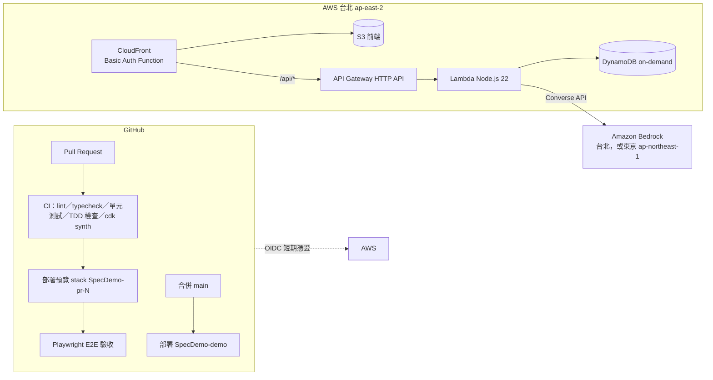

# 參考架構

所有 demo 都從這個架構開始；要新增 AWS 服務時，由 architect 寫 ADR 並經架構師核准。

| 元件 | 用途 | 設定來源 |
|---|---|---|
| CloudFront + S3 | 前端（Vite + React）；`/api/*` 轉給 API Gateway，同一個網域、不用處理 CORS | `infra/lib/demo-stack.ts` |
| CloudFront Function | 預覽與 demo 環境的 Basic Auth | GitHub secret `BASIC_AUTH` |
| API Gateway HTTP API + Lambda | 後端 API | `packages/api` |
| DynamoDB | 資料儲存，on-demand 計費 | 預覽環境隨 stack 刪除；demo 環境保留 |
| Amazon Bedrock | AI，透過 Converse API，可替換模型 | CDK context `bedrockRegion`、`bedrockModelId` |
| GitHub OIDC 角色 | CI 部署，不使用長期 Access Key | `infra/lib/github-oidc-stack.ts` |

## 環境

| 環境 | Stack 名稱 | 何時建立 | 何時刪除 |
|---|---|---|---|
| 預覽 | `SpecDemo-pr-{N}` | PR 開啟或更新 | PR 關閉 |
| Demo | `SpecDemo-demo` | 合併到 `main` | 手動 |
| 個人開發 | `SpecDemo-dev` | 本機 `npx cdk deploy`（需要 AWS 權限） | 手動 |

## 成本控制

- 全部是 serverless，閒置時幾乎不產生費用；主要成本是 Bedrock token。
- Lambda 限制 `MAX_TOKENS=512`、問題長度 1000 字。
- PR 關閉時自動刪除預覽 stack。
- 請在 AWS Budgets 設定每月預算警示（見 `docs/aws-setup.md`）。
