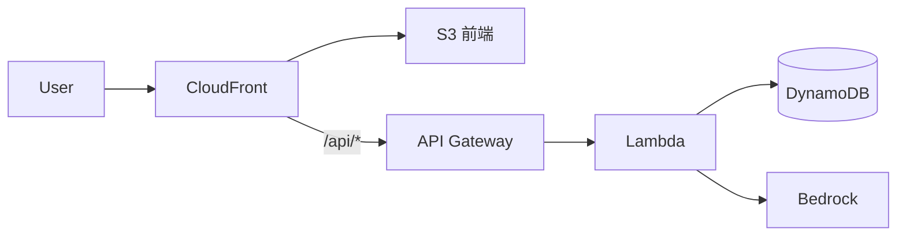

# SPEC-{id} 技術設計

狀態：草稿 ｜ 架構師：@{architect} ｜ 對應需求：requirements.md

## 1. 架構

## 2. API 規格
| 方法 | 路徑 | Request | Response | 錯誤碼 |
|---|---|---|---|---|

## 3. 資料模型

## 4. Bedrock 設計
- 用途：
- System prompt 摘要：
- 輸入上限／輸出上限（tokens）：
- 不得送入模型的資料：

## 5. 安全與法遵考量

## 6. AC 對照表
| AC | 元件 | 測試檔 |
|---|---|---|

## 7. Infra 變更
- 新增或修改的 AWS 資源：
- Region（台北可用？）：

## 8. 待確認問題
| # | 問題 | 提出者 | 回答者 | 狀態 |
|---|---|---|---|---|
